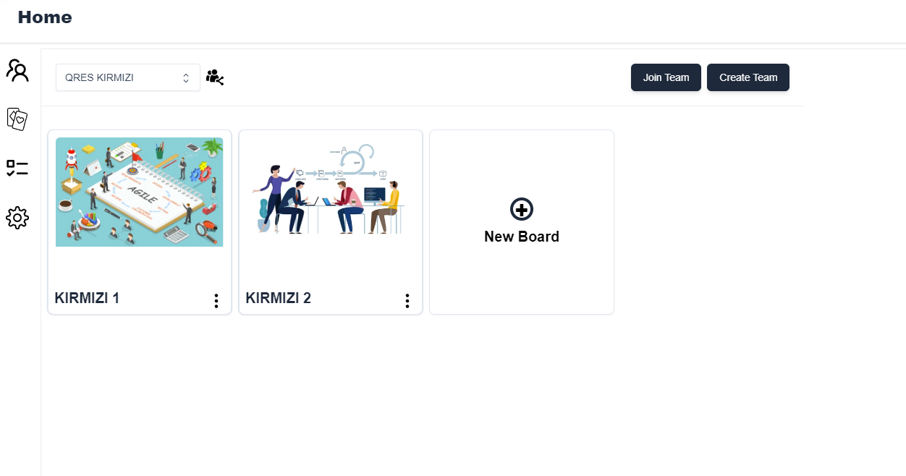
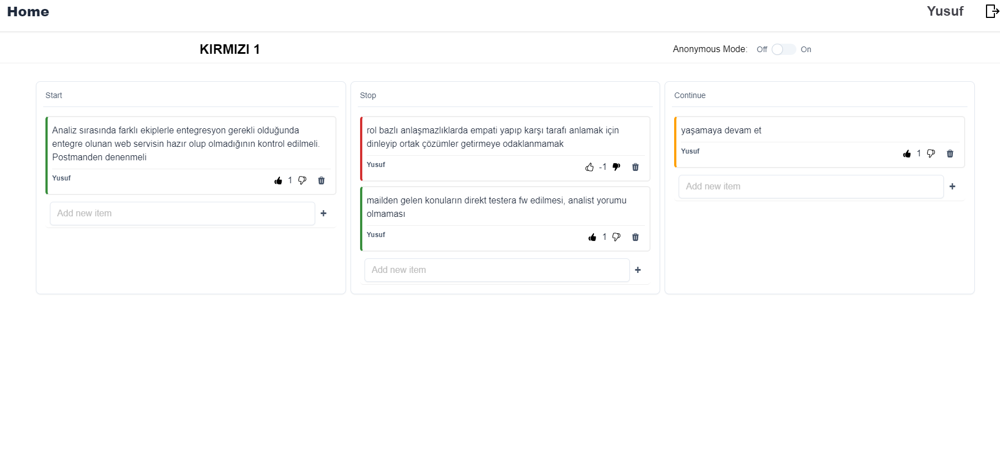

add .env filein project and insert this parameters

`VITE_FIREBASE_API_KEY: *****

VITE_FIREBASE_AUTH_DOMAIN: *****

VITE_FIREBASE_PROJECT_ID: *****

VITE_FIREBASE_STORAGE_BUCKET: ******

VITE_FIREBASE_MESSAGING_SENDER_ID: ******

VITE_FIREBASE_APP_ID: ********

VITE_FIREBASE_MEASUREMENT_ID: *********`

* npm install
* npm run dev

## Reklam alanı ayarları (Firebase)

Ana sayfadaki reklam alanı Firestore'daki `siteConfig/adBanner` dokümanından okunur ve
değişiklikler sayfaya anında yansır. Doküman yoksa koddaki varsayılanlar
(`src/firebase/AdService.js`) kullanılır. Dokümanı Firebase Console > Firestore'dan düzenleyin
(güvenlik kuralları gereği uygulama üzerinden yazılamaz). `firestore.rules` dosyasını
`firebase deploy --only firestore:rules` ile yayınlamayı unutmayın.

| Alan | Tip | Açıklama |
|---|---|---|
| `enabled` | boolean | `false` ise reklam tüm sitede gizlenir |
| `title`, `subtitle` | string | Başlık ve alt başlık |
| `phone` | string | İletişim numarası |
| `sponsoredTooltip` | string | "Sponsored" rozeti üzerindeki yazı |
| `footerNotes` | array<string> | Alt bilgi satırları |
| `products` | array<map> | Ürün kartları (aşağıda) |

Her ürün (`products` içindeki map):

| Alan | Tip | Açıklama |
|---|---|---|
| `name`, `description`, `emoji` | string | Kart içeriği |
| `tooltip` | string | Boş değilse isim yanında `?` ikonu ile gösterilir |
| `stock` | number | Stok miktarı; `0` ise "Stokta Yok" gösterilir |
| `maxStock` | number | İlerleme çubuğu için tam stok değeri (`0` ise çubuk gizlenir) |
| `unit` | string | Birim (ör. `kg`, `Çıta`) |
| `autoDecrease` | boolean | `true` ise `stock` Eylül–Ocak arası tarihe göre otomatik azaltılır, `false` ise aynen gösterilir |

Not: Bir alanı eklediğinizde `products` dizisinin tamamı dokümandaki değerle değiştirilir.
